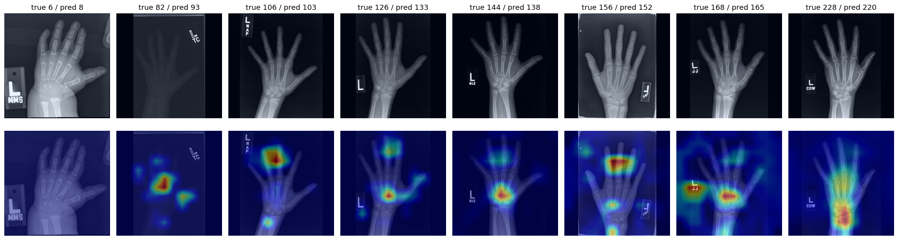
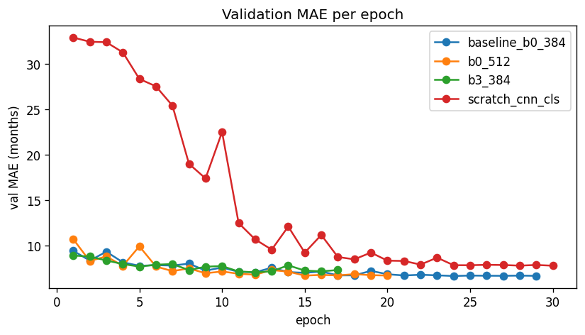
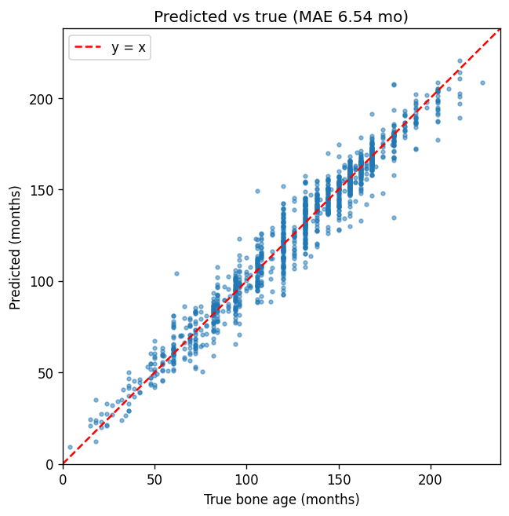
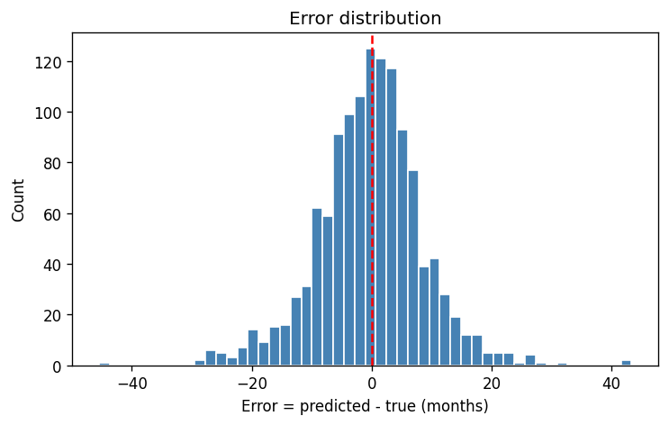
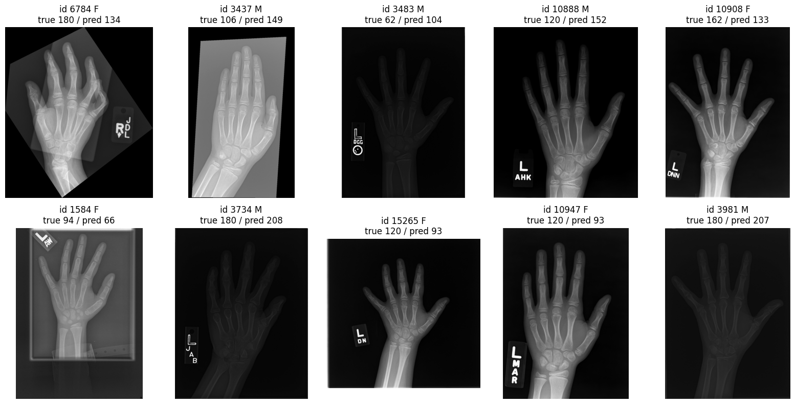

# Pediatric Bone Age Estimation from Hand X-rays

Predicting a child's **bone age (in months)** from a left-hand radiograph and their sex, using the [RSNA Pediatric Bone Age Challenge (2017)](https://www.kaggle.com/datasets/kmader/rsna-bone-age) dataset.

**Result: 6.54 months MAE on a held-out test set** (R² = 0.953). The baseline that ignores the image scores 33.3 months, and the 2017 challenge winner scored 4.27 months on the official test set.


*Grad-CAM: the model focuses on growth plates, carpal bones and, near adulthood, the distal radius. These are the regions radiologists use.*

---

## Problem

Bone age assessment is a routine radiology task for diagnosing growth disorders. A radiologist compares the hand X-ray with an atlas (Greulich–Pyle). The task is slow and varies between readers. Here it is framed as **regression**: the input is an image plus sex, and the output is the bone age in months. The metric is **MAE** (mean absolute error) in months.

## Data

- 12,611 labelled hand X-rays (`boneage-training-dataset`). Ages range from 1 to 228 months (mean 127, std 41). The set is 54% male.
- The Kaggle test CSV has no labels, so the labelled set is split **80 / 10 / 10 (train / val / test)**. The split is stratified on age bins × sex and saved once to `data/splits.csv`.
- Model selection uses the **validation set only**. The **test set is evaluated once**, at the very end.

Key EDA findings ([`02_eda.ipynb`](notebooks/02_eda.ipynb)):
- Image sizes vary widely (521–3001 px wide), and brightness and contrast vary strongly between images. Some images are scanned films with large black borders.
- Labels cluster at multiples of 6 and 12 months (atlas-based rounding). This implies an inherent label noise of roughly 3–6 months.
- Image height correlates with age (r = 0.39) because larger hands produce larger films. Resizing removes this shortcut, so the model has to learn from bone maturity.

## Method

| Component | Choice |
|---|---|
| Pre-processing | Grayscale → 3 channels, aspect-preserving resize + padding to 384 (or 512), ImageNet normalisation, target z-scored with train statistics |
| Augmentation (train only) | Rotation ±15°, shift/scale, brightness/contrast, CLAHE |
| Model | `timm` ImageNet-pretrained backbone (EfficientNet-B0 / B3) → pooled features ⊕ sex embedding (`Linear(1,16)`) → MLP → 1 output |
| Training | L1 loss, AdamW (lr 1e-4 backbone / 1e-3 head), cosine LR schedule, 30 epochs, early stopping (patience 5), mixed precision |
| Inference | TTA (original + ±7° rotations), ensemble = mean of models |

**Second model type, for comparison:** a small **CNN trained from scratch** (no pretraining, 2.5M params). It solves the task as **classification** instead of regression: 241 classes (one per month) trained against a Gaussian soft label (σ = 4 months). The prediction is the expected value of the predicted distribution.

## Results

### Validation (model selection)

| Setup | Val MAE (months) | R² |
|---|---|---|
| **Ensemble (B0-384 + B0-512 + B3-384) + TTA** | **6.26** | 0.961 |
| Ensemble (B0-384 + B0-512 + B3-384) | 6.30 | 0.960 |
| EfficientNet-B0, 384 px + TTA | 6.55 | 0.958 |
| EfficientNet-B0, 384 px | 6.67 | 0.956 |
| EfficientNet-B0, 512 px | 6.72 | 0.955 |
| EfficientNet-B3, 384 px | 7.09 | 0.949 |
| CNN from scratch + classification + TTA | 7.68 | 0.943 |
| CNN from scratch + classification | 7.81 | 0.940 |



### Test (evaluated once, best validation setup)

| Model | Test MAE (months) |
|---|---|
| Baseline: predict train mean | 33.28 |
| Baseline: predict mean per sex | 31.98 |
| **Ours: ensemble + TTA** | **6.54** (RMSE 8.80, R² 0.953) |
| RSNA 2017 winner (official test set, not directly comparable) | 4.27 |

| Age group | 0–5 y | 5–10 y | 10–15 y | 15+ y |
|---|---|---|---|---|
| Test MAE | 5.52 | 7.11 | 6.35 | 6.63 |

| Sex | Female | Male |
|---|---|---|
| Test MAE | 6.81 | 6.32 |

<p float="left">
  
  
</p>

### Takeaways

- **Ensembling gave the largest gain** (6.67 → 6.30 val MAE). TTA added about 0.1 months to every model.
- **Transfer learning matters, but less than expected.** The from-scratch CNN reached 7.8 months, about 1.1 months behind the pretrained B0. It needed 4–5 epochs before it started learning, and it was still improving at epoch 30.
- **A bigger backbone (B3) did not help here.** It early-stopped at epoch 17 while the cosine learning rate was still high, so it never benefited from the low-LR phase.
- **Worst errors** ([`07_test_results.ipynb`](notebooks/07_test_results.ipynb)) fall into three groups: very dark or low-contrast images, unusual positioning (about 35° rotation, bent fingers), and images that look clean, which are likely label noise.



## Limitations

- The test set is our own 10% split, not the official RSNA test set, so the comparison with the winner (4.27) is indicative only.
- Training was done on a single GPU with limited epochs. Early stopping triggered while the cosine LR was still high for some runs. A longer patience, or starting early stopping only after a warm-up period, would likely help.
- Grad-CAM shows the model sometimes attends to the **lead markers** ("L", initials), which is a possible shortcut. Cropping or segmenting the hand would remove it.
- Labels come from single radiologist readings with atlas rounding, so an MAE far below about 4 months is unlikely to be meaningful on this data.

## Project structure

Everything is in Jupyter notebooks, ready for Google Colab.

```
notebooks/
├── 00_common.ipynb              # config + all shared code (dataset, models, training, evaluation, Grad-CAM)
├── 01_setup_data.ipynb          # install, download via kagglehub, cache resized images
├── 02_eda.ipynb                 # exploratory data analysis
├── 03_split_baseline.ipynb      # stratified split + mean baselines
├── 04_dataset_model_check.ipynb # augmented batch + forward-pass check
├── 05_train.ipynb               # baseline model (EfficientNet-B0, 384 px)
├── 06_experiments.ipynb         # 512 px, B3, CNN from scratch, TTA, ensemble (validation only)
├── 07_test_results.ipynb        # final test evaluation (run once)
└── 08_gradcam.ipynb             # explainability
```

Every phase notebook starts with `%run 00_common.ipynb`. Training saves a full checkpoint after every epoch and resumes automatically if the session is interrupted.

## How to run

**Google Colab:** Upload the project folder to `MyDrive/bone-age/` and select a T4 GPU runtime. Then run the notebooks in order. At the start of every new session, run `01_setup_data.ipynb` first, because images are downloaded to the fast local disk.

**Local:** `pip install -r requirements.txt`, then run the notebooks in order from the `notebooks/` folder. On Windows, the DataLoader uses `num_workers=0`, because classes defined in a notebook cannot be sent to worker processes.

Stack: PyTorch, timm, albumentations, scikit-learn, pandas, matplotlib.
